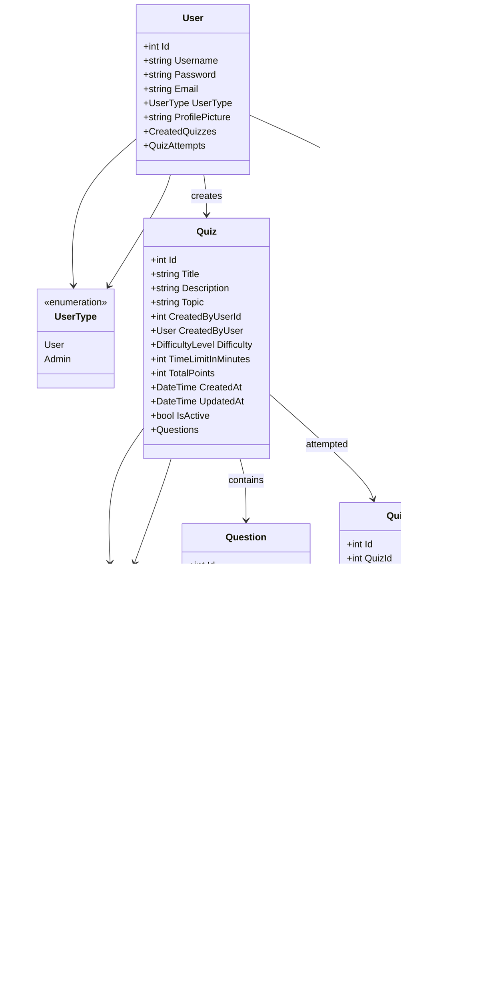

# QuizHub Class Diagram

This diagram shows the domain models and their relationships in the QuizHub system.

## Model Descriptions

- **User**: Represents both admin and regular users with authentication data
- **Quiz**: Contains quiz metadata, difficulty, and timing information
- **Question**: Individual questions within a quiz with various types and scoring
- **QuestionOption**: Multiple choice options for questions (when applicable)
- **QuizAttempt**: Records of user attempts at quizzes with scoring and timing
- **QuizAnswer**: Individual answers within an attempt with correctness tracking
