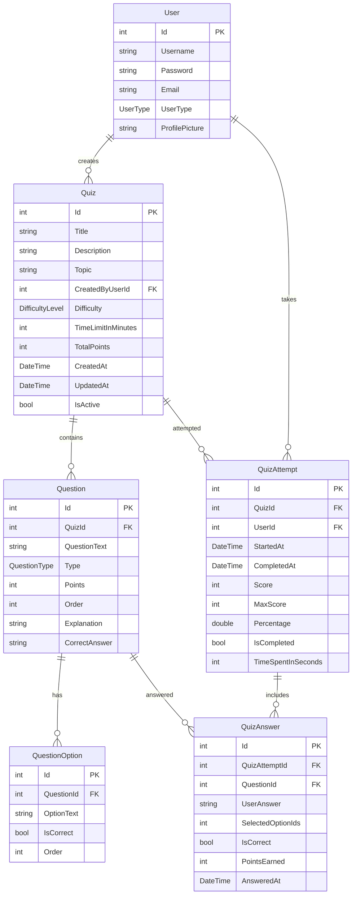

# QuizHub Entity Relationship Diagram

This diagram shows the database structure and relationships between entities in the QuizHub system.

## Key Relationships

- **User to Quiz**: One-to-many (A user can create multiple quizzes)
- **User to QuizAttempt**: One-to-many (A user can attempt multiple quizzes)
- **Quiz to Question**: One-to-many (A quiz contains multiple questions)
- **Quiz to QuizAttempt**: One-to-many (A quiz can be attempted multiple times)
- **Question to QuestionOption**: One-to-many (A question can have multiple options)
- **Question to QuizAnswer**: One-to-many (A question can be answered multiple times)
- **QuizAttempt to QuizAnswer**: One-to-many (An attempt includes multiple answers)