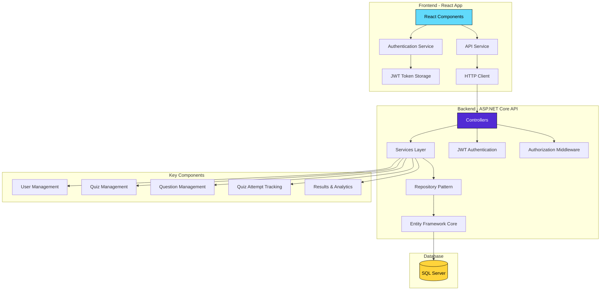

# QuizHub System Architecture

This diagram illustrates the overall application architecture and component relationships.

## Architecture Overview

### Frontend (React)
- **React Components**: User interface components for admin and student views
- **Authentication Service**: Handles login/logout and token management
- **API Service**: Manages all HTTP requests to the backend
- **JWT Token Storage**: Secure storage for authentication tokens

### Backend (ASP.NET Core)
- **Controllers**: API endpoints for handling HTTP requests
- **Services Layer**: Business logic and data processing
- **Repository Pattern**: Data access abstraction layer
- **Entity Framework Core**: ORM for database operations
- **JWT Authentication**: Token-based authentication system
- **Authorization Middleware**: Role-based access control

### Database
- **SQL Server**: Persistent data storage for all application data

### Core Features
- **User Management**: Authentication, authorization, and user profiles
- **Quiz Management**: Creating, editing, and managing quizzes
- **Question Management**: Question creation with various types and options
- **Quiz Attempt Tracking**: Recording and monitoring quiz attempts
- **Results & Analytics**: Performance tracking and progress visualization