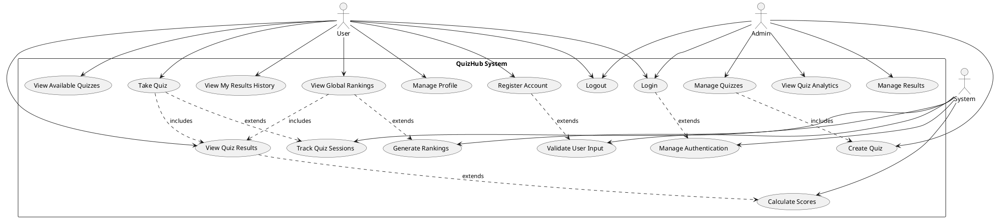

# QuizHub Use Case Diagram

## Actors
- **User** (Regular quiz taker)
- **Admin** (Quiz creator/manager)

## Use Cases

### User Use Cases
1. **Register Account**
   - User can create a new account with username, email, password, and profile picture
   - System validates user information

2. **Login**
   - User can authenticate with username/password
   - System provides JWT token for session

3. **View Available Quizzes**
   - User can browse active quizzes
   - Filter by difficulty, topic
   - Search quizzes

4. **Take Quiz**
   - User can start a quiz attempt
   - Answer questions within time limit
   - Submit answers for each question
   - Complete quiz attempt

5. **View Quiz Results**
   - User can see their quiz attempt results
   - View score, correct answers, explanations
   - See performance breakdown

6. **View My Results History**
   - User can see all their past quiz attempts
   - View progression over time
   - See performance statistics

7. **View Global Rankings**
   - User can see leaderboards
   - Filter by quiz or time period
   - Compare performance with other users

8. **Manage Profile**
   - User can view/update profile picture
   - View user information

9. **Logout**
   - User can end their session

### Admin Use Cases
1. **Login as Admin**
   - Admin can authenticate with admin credentials

2. **Create Quiz**
   - Admin can create new quizzes
   - Add quiz metadata (title, topic, difficulty, time limit)
   - Add questions with multiple types (single choice, multiple choice, true/false, fill-in-blank)
   - Add answer options and mark correct answers

3. **Manage Quizzes**
   - Admin can view all quizzes (active and inactive)
   - Edit existing quizzes
   - Delete quizzes
   - Toggle quiz active/inactive status
   - Filter quizzes by various criteria

4. **View Quiz Analytics**
   - Admin can see quiz attempt statistics
   - View user performance on quizzes

5. **Manage Results**
   - Admin can view all quiz attempts across users
   - Filter attempts by quiz, user, date range
   - View detailed attempt results
   - Delete quiz attempts

6. **Logout**
   - Admin can end their session

## System Use Cases
1. **Validate User Input**
   - System validates form data
   - Provides error messages for invalid input

2. **Manage Authentication**
   - System handles JWT token generation and validation
   - Protects routes based on user roles

3. **Track Quiz Sessions**
   - System manages active quiz sessions
   - Handles time limits and auto-submission

4. **Calculate Scores**
   - System calculates quiz scores based on correct answers
   - Generates performance statistics

5. **Generate Rankings**
   - System calculates user rankings
   - Updates leaderboards based on quiz performance

## Relationships
- User **extends** Guest (for registration/login)
- Admin **extends** User (inherits basic user capabilities)
- Take Quiz **includes** View Quiz Results
- Manage Quizzes **includes** Create Quiz
- View Global Rankings **includes** View Quiz Results

## PlantUML Code

## Mermaid Diagram Code

```mermaid
graph TD
    U[User]
    A[Admin]
    S[System]

    subgraph "QuizHub Use Cases"
        UC1[Register Account]
        UC2[Login]
        UC3[View Available Quizzes]
        UC4[Take Quiz]
        UC5[View Quiz Results]
        UC6[View My Results History]
        UC7[View Global Rankings]
        UC8[Manage Profile]
        UC9[Logout]

        UC10[Create Quiz]
        UC11[Manage Quizzes]
        UC12[View Quiz Analytics]
        UC13[Manage Results]

        UC14[Validate User Input]
        UC15[Manage Authentication]
        UC16[Track Quiz Sessions]
        UC17[Calculate Scores]
        UC18[Generate Rankings]
    end

    %% User connections
    U --> UC1
    U --> UC2
    U --> UC3
    U --> UC4
    U --> UC5
    U --> UC6
    U --> UC7
    U --> UC8
    U --> UC9

    %% Admin connections
    A --> UC2
    A --> UC9
    A --> UC10
    A --> UC11
    A --> UC12
    A --> UC13

    %% System connections
    S --> UC14
    S --> UC15
    S --> UC16
    S --> UC17
    S --> UC18

    %% Relationships
    UC4 -.-> UC5
    UC11 -.-> UC10
    UC7 -.-> UC5
```

